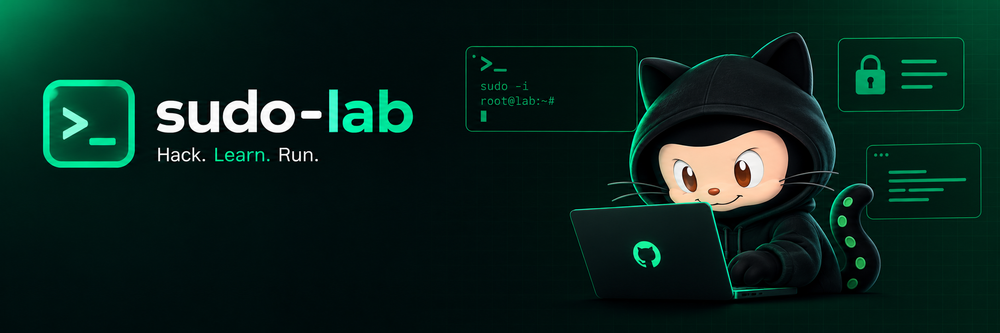

<div align="center">



<h1 align="center">sudo-lab</h1>

**Laboratorio reproducible de diagnóstico y mitigación de vulnerabilidades de `sudo`.**

</div>

Anexo práctico del trabajo de investigación *“Vulnerabilidades en sudo: escalada de
privilegios local, explotación en laboratorio y mitigación”* — Redes de Datos /
Software Seguro, Licenciatura en Sistemas de Información, UNNE – FaCENA.

---

## Uso y alcance

Este proyecto es **educativo y defensivo**. Se ejecuta en un contenedor Docker
**aislado** y está pensado para *fundamentar* el informe con evidencia reproducible:
demuestra que un sistema cumple las precondiciones de explotación de varias CVE de
`sudo` y prueba que las mitigaciones las cierran.

**Qué incluye** (todo defensivo y reproducible):

- El **target vulnerable** (contenedor con una versión concreta de `sudo`).
- Un motor de **diagnóstico de exposición** (`scan.sh`): detecta, CVE por CVE, si el
  sistema es explotable combinando versión + precondiciones reales.
- Un motor de **mitigación** (`mitigate.sh`): aplica controles compensatorios y permite
  re-escanear para verificar el efecto.
- Un **dashboard** (Next.js 15 + Tailwind v4) que orquesta todo y muestra los registros
  en vivo.

**Qué NO incluye, a propósito:** el repositorio **no contiene los payloads ofensivos**
(ni el webshell de RCE del acceso inicial, ni el exploit de escalada a root). Escribir
un exploit funcional queda fuera del alcance, aun con fin educativo. El diagnóstico ya
demuestra la explotabilidad de forma reproducible; para la demostración ofensiva en
vivo, la metodología está documentada en el informe y se apoya en PoC **públicos** ya
citados (p. ej. el repositorio `chwoot` para CVE-2025-32463). Ejecutarlos, si la cátedra
lo requiere, es responsabilidad de quien corre el laboratorio, siempre dentro de este
entorno aislado.

---

## Arquitectura

```
┌───────────────────────────────┐        docker exec         ┌──────────────────────────┐
│  Dashboard (Next.js 15)        │ ─────────────────────────► │  Contenedor target       │
│  - Diagnosticar                │                            │  (sudo-lab-target)       │
│  - Aplicar mitigaciones        │   scan.sh / mitigate.sh    │  hostname: srv-web       │
│  - Re-escanear / Restaurar     │ ◄───────────────────────── │  sudo 1.9.15 (vulnerable)│
│  - Logs en vivo                │     TSV + logs (stderr)    │  /tmp tmpfs · SYS_ADMIN  │
└───────────────────────────────┘                            └──────────────────────────┘
```

El dashboard nunca “ataca”: ejecuta los scripts de diagnóstico/mitigación dentro del
contenedor mediante `docker exec` y renderiza el resultado.

---

## Requisitos

- Docker + Docker Compose
- Node.js 18.18+ (para el dashboard)

---

## Puesta en marcha

### 1) Levantar el target

```bash
docker compose up -d --build
```

Esto compila `sudo 1.9.15` (vulnerable a CVE-2025-32463) dentro del contenedor
`sudo-lab-target`. Para estudiar otro rango, cambiá `SUDO_VERSION` en
`docker-compose.yml`.

Verificación rápida por consola:

```bash
docker exec sudo-lab-target bash /opt/lab/scripts/scan.sh   # diagnóstico
```

### 2) Levantar el dashboard

```bash
cd dashboard
npm install
npm run dev
# abrí http://localhost:3000
```

Flujo sugerido en el panel: **① Diagnosticar** → **② Aplicar mitigaciones + re-escanear**
→ comparás cómo los hallazgos pasan de `EXPLOTABLE` a `MITIGADO`. **↺ Restaurar** vuelve
al estado vulnerable para repetir la demo.

> El dashboard usa la variable `LAB_CONTAINER` (por defecto `sudo-lab-target`) para
> saber contra qué contenedor ejecutar.

---

## CVEs evaluadas

| CVE | Vector | Rango vulnerable | Precondición que chequea el lab |
| --- | --- | --- | --- |
| CVE-2025-32463 | chroot / NSS (crítica 9.3) | 1.9.14 – 1.9.17 | versión en rango + `/tmp` ejecutable |
| CVE-2025-32462 | opción host (baja 2.8) | 1.8.8–1.8.32 / 1.9.0–1.9.17 | regla de sudoers calificada por host remoto |
| CVE-2023-22809 | `sudoedit` + EDITOR (alta 7.8) | 1.8.0 – 1.9.12p1 | regla de `sudoedit` en sudoers |
| CVE-2021-3156 | Baron Samedit (alta 7.8) | 1.8.2–1.8.31p2 / 1.9.0–1.9.5p1 | chequeo seguro `sudoedit -s /` (método Qualys) |
| CVE-2019-14287 | Runas `-u#-1` (alta 7.8) | < 1.8.28 | regla Runas con `ALL` y negación de root |

La lógica de estado es: *sin versión vulnerable* → `NO_AFECTADO`; *versión vulnerable +
precondición presente* → `EXPLOTABLE`; *versión vulnerable pero precondición cerrada* →
`MITIGADO`.

---

## Mitigaciones que aplica `mitigate.sh`

1. **Hardening de `sudoers`** — elimina la negación en Runas (2019), la regla de
   `sudoedit` amplia (2023) y la regla calificada por host remoto (2462).
2. **`/tmp` noexec,nosuid,nodev** — control compensatorio que impide ejecutar el `.so`
   que las técnicas de chroot (2025-32463) y Baron Samedit necesitan preparar.

> La mitigación **completa** de las CVE de 2025 es actualizar a `sudo 1.9.17p1` o
> posterior. Los controles de arriba son **compensatorios**, pensados para el escenario
> del informe: un sistema *legacy* que no puede parchearse sin romper el servicio.

---

## Estructura del repositorio

```
sudo-lab/
├── docker-compose.yml        # orquestación del target
├── lab/
│   ├── Dockerfile            # compila el sudo vulnerable
│   ├── entrypoint.sh         # crea usuarios + instala sudoers de laboratorio
│   └── sudoers.lab           # reglas con las "señales" de cada CVE
├── scripts/                  # se montan en el contenedor en /opt/lab/scripts
│   ├── lib.sh                # logging + comparador de versiones de sudo
│   ├── scan.sh               # diagnóstico de exposición (TSV + logs)
│   └── mitigate.sh           # mitigaciones + --reset
└── dashboard/                # Next.js 15 + Tailwind v4
    ├── app/                  # UI + API routes (docker exec)
    └── lib/lab.ts            # runner + parser del TSV
```

---

## Mapeo con el informe

- **Fase 1 (acceso inicial por Apache)** → documentada en el informe; en el lab se
  representa con el usuario `webuser` (foothold sin privilegios).
- **Fase 2 (escalada por sudo)** → `scan.sh` prueba que todas las precondiciones de
  CVE-2025-32463 se cumplen; la ejecución del PoC público es opcional y externa.
- **Fase 3 (defensa)** → `mitigate.sh` + re-escaneo = evidencia de qué controles
  funcionan y cuáles no, tal como analiza la sección de mitigación.
